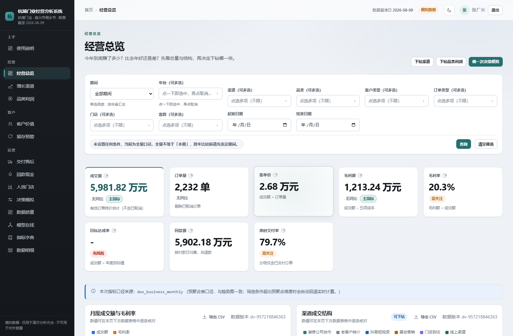

# 杭博门业 · 经营分析系统（求职作品集版）

[](https://github.com/5x486/door-manufacturer-analytics/actions/workflows/ci.yml)

> 给一家小型定制门厂做一套**能算钱、能追责、能解释**的经营分析系统：
> 从 8 张业务表入仓，到 56 条指标口径、14 个分析页面、21 个接口，再到测试与 CI。
>
> **数据说明**：全部交易数据由程序按固定随机种子生成，不含真实个人或企业信息。
> 业务原型（品类、渠道、交付流程）依据行业公开信息校准，用于演示分析方法与工程实现。

---

## 30 秒看懂

| | |
|---|---|
| **是什么** | 面向定制门制造企业的经营分析系统：33 张表的经营数据仓库 + 56 条指标口径 + 14 个分析页面 + 21 个 REST 接口 |
| **业务原型** | 2023 年起步的小厂：1 个工厂展厅、抖音短视频接单、老客户转介、少量装企合作；主营铜门、不锈钢门、铸铝门、防火门等 6 大品类 |
| **数据规模** | 2023-01 至 2026-07：1,500 客户、2,401 订单（有效 2,232）、3,087 明细、5,982 付款、189 售后、48 个 SKU，成交额 5,981.82 万元 |
| **我做了什么** | 数据接入与质检、四层数据建模、指标口径入库、分析服务层、页面与 API、测试与部署配置 |
| **三个结论** | 品类集中（不锈钢门 53.4%）、客户集中（214 名贡献 41.1% 收入）、履约与现金承压（准时率 79.7%，应收 86.16 万元） |

---

## 数据是模拟的，那这个项目在证明什么

面试里我一定会被问这一句，所以先说清楚：

1. **证明方法能迁移**：口径定义、归因路径、取舍逻辑都不依赖具体数字。换一套真实数据，方法照用。
2. **证明过程可审计**：固定随机种子，一条命令重跑，结果完全一致；口径带编码与版本，改口径能追溯到旧结论。
3. **证明工程能落地**：数据质量规则进 CI，error 级失败会阻断发布，而不是等报表出错再回头查。

它不能证明的也写在明处：不能证明这家厂真实经营如此，也不能替代真实脏数据的处理经验。

---

## 三个核心发现与对应动作

### 1. 品类：不锈钢门占收入 53.4%，前 3 品类约 80%

毛利率整体 20.3%，材料成本占五项成本约 52%，铜门毛利率最高但交付周期最长。
**动作**：不锈钢跑量、铜门做利润；对铜价做敏感性测算，报价单里预留材料波动区间。

### 2. 客户：214 名高价值客户贡献 41.1% 收入

人均消费 11.5 万元，平均复购 3.7 次，占全部客户 14.3%。
**动作**：高价值客户专属权益与转介绍激励；对「需挽留」客群按复购间隔做触达，而不是群发。

### 3. 履约与现金：准时率 79.7%，应收 86.16 万元

延期主要集中在产能与缺料；应收中 90 天以上 71.30 万元，逾期 81.20 万元。
**动作**：下单时给足交付预期、关键节点对客户可见；把 90 天以上应收单独列示，进坏账计提口径。

---

## 系统长什么样

13 个页面截图在 [`outputs/screenshots/`](outputs/screenshots/)，从经营总览到决策模拟、数据质量、模型在线都有。



| 页面 | 回答什么业务问题 |
|---|---|
| 经营总览 | 这一年到底做得怎么样 |
| 增长与渠道 | 增长从哪来，钱投哪条渠道划算 |
| 品类与利润 | 哪类门赚钱，哪类只是卖得多 |
| 客户价值 / 客户 360 | 谁是最重要的客户，这一个客户的来龙去脉 |
| 留存与预警 | 客户还会不会回来 |
| 交付与售后 | 交付卡在哪一步 |
| 回款与现金流 | 钱什么时候回来 |
| 人效与门店 | 人和店面的产出效率 |
| 决策模拟 | 调价、调结构会发生什么（7 个参数 what-if + 历史回测） |
| 数据质量 | 这份数据能不能信 |
| 模型在线 | 模型有没有用，某条评分为什么是这个值 |
| 指标字典 | 56 条口径怎么定义、怎么拆解 |

---

## 它是怎么被做成系统的

| 层 | 做法 | 为什么 |
|---|---|---|
| 数据层 | 33 张表分四层：主数据 7 / 业务事实 9 / 分析治理 13 / 质量 3 / 系统 1 | 主数据被事实表引用，事实表只追加，预聚合物化在治理层 |
| 指标层 | 56 条口径入库（编码、公式、单位、排除规则、版本），44 条拆解关系 | 讨论时说的是 M_REV_001，不是「你说的那个营收」 |
| 服务层 | selectors 只读查询，services 纯函数；页面与 API 共用 | 同一个指标只有一种算法，改口径只改一处 |
| 质量层 | 25 条规则分五类，结果与异常主键落库 | 能看到「上周还好，这周主键重复了」 |
| 性能 | 8 张 dws_* 预聚合，约 3,700 行，重建 0.7 秒 | 页面查询走预聚合，不再每次从明细聚合 |
| 工程 | pytest 80 个用例、GitHub Actions 三 job、Docker Compose、OpenAPI 文档 | 口径、契约、幂等、页面冒烟都有断言 |

---

## 怎么跑起来

```powershell
python -m venv .venv
.venv\Scripts\activate
pip install -r requirements.txt

# 起库（Windows 自带脚本，用项目内 MySQL 实例，端口 3307）
pwsh tools/devops.ps1 pipeline

# 起服务
pwsh tools/devops.ps1 run
```

浏览器打开 http://127.0.0.1:8080 ，演示账号 `admin / admin123456`。

不想用脚本也可以：

```powershell
python manage.py migrate
python manage.py seed_demo
python manage.py sync_metrics
python manage.py build_dws
python manage.py runserver 127.0.0.1:8080
```

---

## 目录导航

| 想看什么 | 去哪 |
|---|---|
| 完整技术说明 | [README.md](README.md) |
| 数据字典 | [docs/data_dictionary.md](docs/data_dictionary.md) |
| 页面截图 | [outputs/screenshots/](outputs/screenshots/) |
| 指标口径 | 系统内「指标字典」页，或 `apps/analytics/metrics.py` |
| 预聚合与幂等 | `apps/analytics/etl.py` |
| 数据质量规则 | `apps/dq/rules.py` 与 `apps/dq/checks.py` |
| 页面与接口 | `apps/dashboard/`、`apps/api/` |
| 测试 | `tests/` |

---

## 边界与下一步

**已知边界**：数据为模拟；未公网部署；批式重建，没有调度；整体测试覆盖率 54%，核心服务层更高；页面文件偏大，后续会按业务域拆分。

**下一步**：接入真实公开数据做第二项目（区域经济或零售）；加 Celery 定时刷新预聚合与评分；补行级权限，让业务员只看自己的单。

---

## 关于我

统计学本科（2028 届），两段实习：农商行柜面与信贷条线、镇政府经济发展办公室，接触过一手业务数据与基层统计报表。目标岗位是经营分析 / 数据分析。

如果这个项目只能留下一个印象，我希望是：**我知道每个数字是怎么来的。**
